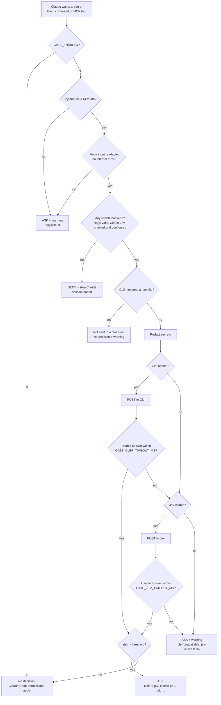
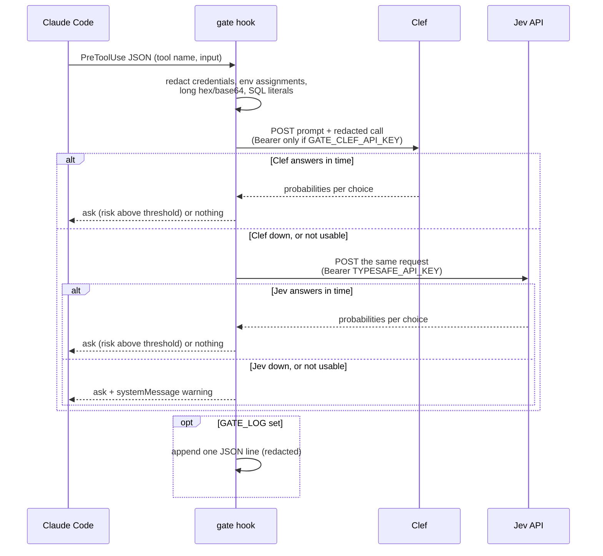
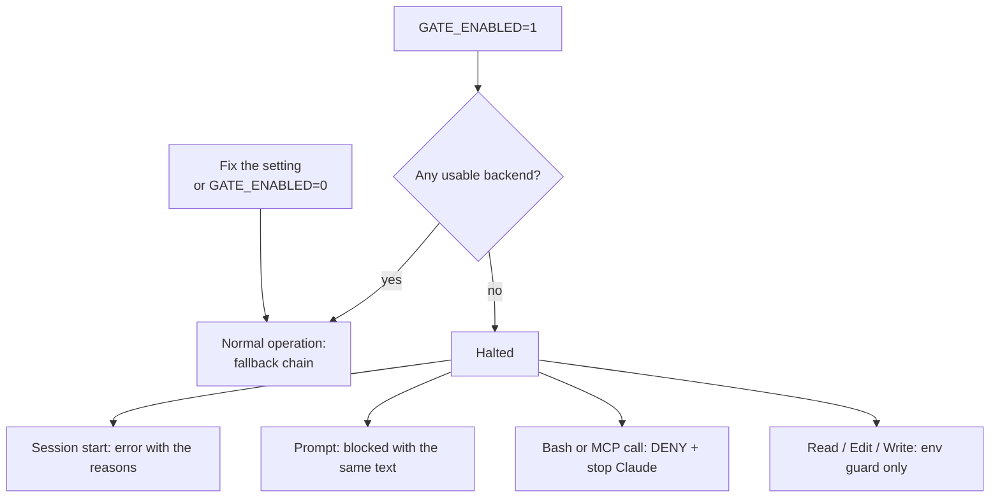
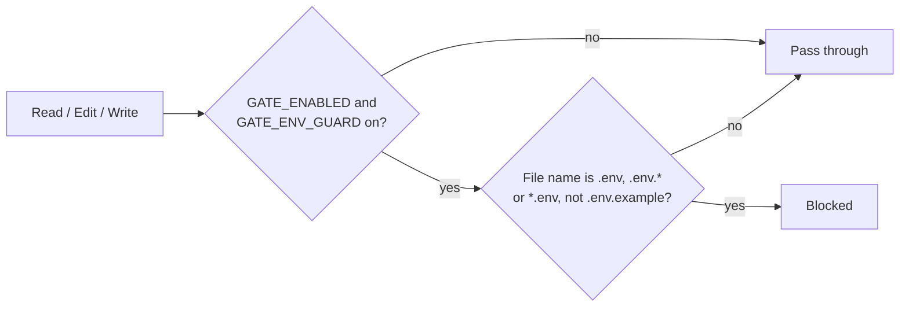
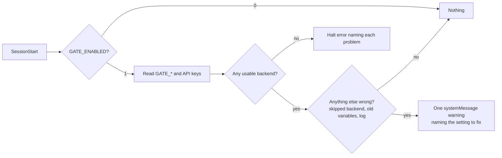

# destructive-guard

A `PreToolUse` approval gate for Claude Code. Before a Bash command or an MCP
tool call runs, the gate sends it (redacted) to a classifier and **asks you
first** when the classifier judges that the call could delete, overwrite or
irreversibly change data or resources, on the local machine or in a remote
service. It also blocks Read/Edit/Write of `.env` files.

There are two classifiers, tried in this order: **Clef** (a Jev-compatible
decision model, typically served locally, for example with Ollama at
`http://localhost:11434/v1/systemone`) and **Jev** (the hosted classifier,
needs `TYPESAFE_API_KEY`). The first one that answers decides.

**Privacy: what leaves your machine depends on the backend.** Every Bash
command and MCP tool input (redacted, see [What is sent](#what-is-sent)) goes
to **Clef**, and to **Jev** only when Clef did not answer and a Jev key is set.
A Clef served on your own machine (the default URL) keeps every call on the
machine; a remote `GATE_CLEF_URL` or Jev sends it away. To keep calls strictly
local, set `GATE_JEV_ENABLED=0`.

**Defaults (both backends on, no Jev key, no local Clef): every Bash and MCP
call asks**, with `clef-unavailable: network error`, because no classifier can
answer. Start a local Clef, set `TYPESAFE_API_KEY`, or choose a backend with
`GATE_CLEF_ENABLED=0` / `GATE_JEV_ENABLED=0`. With **no usable backend** (for
example `GATE_CLEF_ENABLED=0` and no Jev key) the session **halts**, see
[Halt](#halt-no-usable-classifier).

- **Asks, never allows.** The hook prints `ask`, nothing, or (only when the
  session is halted) `deny`. When it prints nothing, Claude Code's own
  permission rules and mode decide, so the plugin can only add prompts and
  never removes one.
- **A classifier decides; if none can, a person does.** A usable backend that
  does not answer (timeout, HTTP error, network error, malformed answer) is
  skipped for the next one. When all usable backends fail, the call asks with
  a warning.
- **No usable classifier halts the session.** Every Bash/MCP call is denied
  and every prompt is rejected until you fix a setting or set `GATE_ENABLED=0`.
- **No rules, no parser.** It judges the command text as the classifier sees it.
- **`.env` files are protected twice.** Read/Edit/Write of them is blocked, and
  a Bash or MCP call that mentions one is never sent to a classifier.

## Install

```text
/plugin marketplace add gep/gep-claude-marketplace
/plugin install destructive-guard@gep-claude-marketplace
```

Install it once at user scope to protect every session. Run a local Clef, or
set your Jev key in the `env` block of `~/.claude/settings.json`, or both:

```json
{ "env": { "TYPESAFE_API_KEY": "..." } }
```

Requires **Python >= 3.14** (standard library only, no packages to install).
The hooks use `GATE_INFRA_PYTHON` if set, else `python3.14`, else `python3`
from `PATH`, and start it in isolated mode (`-I`). With no suitable Python
(missing, or older than 3.14, as the system `python3` often is), every gated
call asks with `plugin-fault: no Python >= 3.14 found` and a warning; it never
allows, and it never halts (the prompt gate stays silent). Install 3.14 with
Homebrew (`brew install python@3.14`), `uv python install 3.14`, pyenv
(`pyenv install 3.14`) or from python.org, and, if it is not first on `PATH`
as `python3.14`/`python3`, set `GATE_INFRA_PYTHON` to its path.

## How it works

The plugin registers four hooks in `hooks/hooks.json`:

| Hook | Matches | Job |
| --- | --- | --- |
| `PreToolUse` → `hooks/gate.sh` | `Bash`, `mcp__.*` | Ask the classifiers (Clef, then Jev) whether the call is risky; print `ask`, `deny` (halted) or nothing |
| `PreToolUse` → `hooks/env-guard.sh` | `Read`, `Edit`, `Write` | Block access to `.env` files |
| `SessionStart` → `hooks/session-start.sh` | every session | Warn once about misconfiguration; report a halt |
| `UserPromptSubmit` → `hooks/prompt-gate.sh` | every prompt | Reject the prompt while the session is halted |

### A Bash or MCP call

`gate.sh` finds a Python >= 3.14 and runs the hook. The hook reads the tool
call, redacts it and sends it to the first usable backend, which returns a
probability for each choice of the prompt (by default `read_only`,
`reversible_change`, `destructive`). The **risk** is the sum of the
probabilities of the "ask" choices. Above `GATE_JEV_ESCALATE_THRESHOLD`
(default `0.5`) the hook prints `ask`; otherwise it prints nothing, and Claude
Code's own permission rules and mode decide as if the plugin were not
installed.

A backend is **usable** when it is enabled (`GATE_CLEF_ENABLED`,
`GATE_JEV_ENABLED`) and its settings are valid (Jev needs `TYPESAFE_API_KEY`;
Clef needs a valid URL, a key is optional). Unusable backends are skipped. A
usable backend that does not answer falls through to the next one; the first
answer decides.



Every outcome is **ask**, **no decision** or, only in the halted state,
**deny**. There is no path to `allow`. A settings `deny` rule still wins over
the hook's `ask`, and an `ask` prompts even for allow-listed commands and in
bypass mode (see [Claude Code assumptions](#claude-code-assumptions)).

### The exchange with a classifier



Retries on HTTP 429/529 happen inside each backend's timeout budget. Only the
redacted call and the prompt leave the machine; see [What is sent](#what-is-sent).

### Halt: no usable classifier

When `GATE_ENABLED=1` and **no backend is usable**, the gate cannot do its job
and stops the session instead of letting calls through unjudged:

- **Session start** shows an error naming each backend's problem.
- **Every user prompt is rejected** (`UserPromptSubmit`, `decision: block`).
- **Every Bash and MCP call is denied** and Claude stops (`permissionDecision:
  deny`, `continue: false`), even a call that mentions `.env`, and even with
  an allow rule or in bypass mode.

The way out: fix the setting the message names, or set `GATE_ENABLED=0`.
Read/Edit/Write calls are not part of the halt (the `.env` guard still runs).
A bad `GATE_*` flag (for example `GATE_ENV_GUARD=maybe` or
`GATE_CLEF_ENABLED=maybe`) halts too: the gate cannot tell what you meant.
A bad value that both backends share (`GATE_JEV_ESCALATE_THRESHOLD`,
`GATE_JEV_PROMPT`, `GATE_JEV_INSTRUCTIONS`, ...) makes both unusable and halts;
a bad value of one backend (`GATE_JEV_TIMEOUT_MS`, `GATE_CLEF_URL`) only skips
that backend. **No Python is not a halt**: `gate.sh` asks on every call, session
start warns, and the prompt gate stays silent. A plugin fault in the prompt
gate never blocks a prompt.



### Files: the `.env` guard

`env-guard.sh` runs without Python. It looks only at the file name of a
Read, Edit or Write: `.env`, `.env.*` and `*.env` are blocked, `.env.example`
is allowed, and `GATE_ENV_GUARD=0` turns the guard off.



### Session start

Once per session the plugin checks its settings and shows at most one message.
It never contacts a backend. Halted: the error text and `continue: false`
(Claude Code ignores that at session start, A8; the prompt gate and the hook do
the blocking). Not halted: one warning listing each skipped backend, removed
0.8 variables, an unwritable `GATE_LOG`, or no suitable Python. A skipped
backend is silent per call; it never asks just because a setting is wrong.



### The prompt gate

`UserPromptSubmit` runs `hooks/prompt-gate.sh` for every prompt. It prints
nothing, except while the session is halted: then it prints `decision: block`
with the halt text, and Claude Code rejects the prompt and shows the reason. It
never contacts a backend. With no suitable Python it is silent.

## What it does

| Call | Result |
| --- | --- |
| Bash command or MCP tool call, a classifier answers "risky" (risk above `GATE_JEV_ESCALATE_THRESHOLD`) | **ask**, reason `clef: <choice> p=... risk=...` or `jev: ...` (whoever answered) |
| Same, the classifier answers "not risky" or is unsure | no decision: Claude Code's own permissions apply |
| Clef is usable but gives no answer, Jev answers | Jev's answer decides (reason `jev: ...`) |
| Every usable backend gives no usable answer | **ask** with a warning, reason `clef-unavailable: <cause>; jev-unavailable: <cause>` (one per backend tried) |
| Call that mentions a `.env` file | not sent; no decision, plus a warning |
| Plugin fault: unreadable hook input, no suitable Python, internal error | **ask** with a warning, reason `plugin-fault: <cause>` |
| No usable backend (both off, or misconfigured, or a bad flag) | **halt**: Bash/MCP call **denied**, prompts blocked, session start error |
| Read, Edit or Write of `.env`, `.env.*`, `*.env` (not `.env.example`) | **blocked** by the env guard (`GATE_ENV_GUARD=0` turns it off). Only the file name is matched, so `config.environment.ts` is fine. |
| Any other tool | not gated |

The hook never emits `allow` and cannot print it; `deny` exists only for the
halt. That is the claim the formal model proves (see
[Formal model](#formal-model)).

### What it no longer does

Version 0.8 had rule packs, a shell parser, a script scanner and fail-closed
asks on configuration errors. All of that is gone (see
[Migration from 0.8](#migration-from-08)). Since 2.0, **without any classifier
the plugin halts the session** instead of running as a `.env` guard; see
[Migration from 1.0](#migration-from-10).

### Known blind spots

- **Scripts a command runs.** `bash cleanup.sh` is judged by its text only;
  the classifier does not see what `cleanup.sh` contains (decision D4). Same
  for `psql -f file.sql`.
- **`.env` calls are never judged.** A call that mentions `.env` is not sent
  to a classifier (so its content is not leaked), which also means nothing
  judges it; Claude Code's own permissions apply. (While halted it is denied.)
- **Every call asks when no classifier runs.** With the defaults and no local
  Clef and no Jev key, each Bash and MCP call asks (`clef-unavailable`), as
  during any outage; unattended agents stop at the first call, which is
  intended. This also holds for a broken install (bad hook input, no Python,
  internal error, D12) until it is fixed or `GATE_ENABLED=0` is set.
- **Worst-case latency is the sum of both budgets.** When Clef is down slowly
  (a timeout, not a refused connection) and Jev then also fails, a call waits
  `GATE_CLEF_TIMEOUT_MS` + `GATE_JEV_TIMEOUT_MS`, 4.5 s by default.
- **A cold Clef is slow.** The first call after the model was unloaded can
  take about 14 s, longer than the 3 s default budget: that call falls
  through to Jev (or asks once when Jev is not usable). Warm calls take about
  100 ms to 2 s.
- Calls from tools other than Bash and `mcp__*` are not gated.

## Warnings and what to do

Warnings are `systemMessage` texts shown to you. Each one starts with
`destructive-guard:`.

| When | Warning | What to do |
| --- | --- | --- |
| Session start | `no classifier available (clef: disabled by GATE_CLEF_ENABLED=0; jev: TYPESAFE_API_KEY is not set): this session is halted. Fix the setting or set GATE_ENABLED=0.` (also the reason a prompt is rejected, and the text with each denied call) | Enable a backend and fix its setting, or `GATE_ENABLED=0`. `/destructive-guard:check --config` shows what the gate sees. |
| Session start | `jev: TYPESAFE_API_KEY is not set (skipped this session)`, `clef: GATE_CLEF_URL must use https (skipped this session)`, `jev: GATE_JEV_TIMEOUT_MS must be an integer from 1 to 30000 (skipped this session)`: one backend is skipped, the other still works | Fix the named variable, or ignore it when you want only the other backend. |
| Session start | `GATE_JEV_ESCALATE_THRESHOLD must be a number from 0 to 1`, an unreadable or invalid prompt file, a bad `GATE_ENABLED`/`GATE_ENV_GUARD`/`GATE_*_ENABLED` value | Shared values and flags break every backend: the session halts. Fix the named variable. |
| Session start | `ignoring the removed 0.8 variables ...` | Delete those variables from your settings (see [Migration](#migration-from-08)). |
| Session start | `cannot write GATE_LOG <path> (<reason>): no log this session` | Point `GATE_LOG` at a writable file. Missing directories are created; this warning means the path itself cannot be written (a file in the way, no permission). |
| Session start | `no Python >= 3.14 found (set GATE_INFRA_PYTHON): every Bash and MCP call will ask this session` | Install Python 3.14 or set `GATE_INFRA_PYTHON`. |
| Per call | `Clef did not answer in time (3000 ms); asking you instead.` (Jev's text is the same with `Jev` and `1500 ms`; with two failures they are joined: `Clef could not be reached; Jev did not answer in time (1500 ms); asking you instead.`) | Answer the prompt. Raise `GATE_CLEF_TIMEOUT_MS` / `GATE_JEV_TIMEOUT_MS` if it repeats. |
| Per call | `Clef returned http 503; asking you instead.` (same for Jev) | Answer the prompt; check the key and URL if it repeats (a 401/403 means a wrong key). |
| Per call | `Clef could not be reached; asking you instead.` (same for Jev) | Start Clef, or check the network. During a long outage set `GATE_ENABLED=0`, or `GATE_CLEF_ENABLED=0` when you only use Jev. |
| Per call | `Clef's answer was malformed; asking you instead.` (same for Jev) | Answer the prompt. If it repeats, check the URL and model setting of that backend and report it. |
| Per call | `call mentions a .env file and was not sent to a classifier; Claude Code's permissions apply` | Nothing; this is information. |
| Per call | `could not read the hook input`, `no Python >= 3.14 found`, `internal error (...)`; reason `plugin-fault: ...` | The install is broken: fix Python or update the plugin. `GATE_ENABLED=0` turns the gate off meanwhile. |

Every per-call warning except the `.env` one ends with `GATE_ENABLED=0 turns the gate off.`

## Configuration

Only env variables; no config file is needed. Set them in the `env` block of
`~/.claude/settings.json` for every project, or of a project's
`.claude/settings.json` to override per project. `GATE_LOG` and a file path in
`GATE_JEV_PROMPT` take an absolute path or one relative to the project:
`CLAUDE_PROJECT_DIR` (Claude Code sets it for hooks), else the git root of the
current directory.

| Variable | Default | Meaning |
| --- | --- | --- |
| `GATE_ENABLED` | `1` | `0` turns all hooks and the session warning off (no Python is started). The only off switch. |
| `GATE_ENV_GUARD` | `1` | `0` allows Read/Edit/Write of env files. |
| `GATE_LOG` | unset | File to append one JSON line per handled call: `ts`, `tool`, `command` or `input` (redacted; `null` when it mentions `.env`), `backend` (who answered, `null` when none), `fallback` (`[{backend, error, latencyMs}]`, the backends tried before), `probabilities`, `risk`, `usage`, `latencyMs` (all backends together), `decision` (`ask`/`deny`/`none`), `reason`, `warning`, and `misconfigured` when a setting is invalid. Missing directories are created. Not logged: calls when the gate is off, plugin faults that stop before Python runs (no Python, engine exit), and `.env` blocks of Read/Edit/Write. |
| `GATE_INFRA_PYTHON` | unset | Python interpreter for the hooks and the check script (see [Install](#install)). A broken value is a plugin fault, with no fallback. |
| `GATE_CLEF_ENABLED` | `1` | `0` skips Clef. |
| `GATE_JEV_ENABLED` | `1` | `0` skips Jev (and nothing is sent to the hosted service). |
| `GATE_CLEF_URL` | `http://localhost:11434/v1/systemone` | Clef endpoint. Same rule as Jev: `https`, or plain `http` only to `localhost`/`127.0.0.1`/`[::1]`. |
| `GATE_CLEF_MODEL` | `clef` | Model name sent with the request. |
| `GATE_CLEF_TIMEOUT_MS` | `3000` | Clef's own time budget including retries on 429/529, 1-30000. Exceeding it falls through to Jev. Covers warm calls only; a cold model load (about 14 s) falls through once. |
| `GATE_CLEF_API_KEY` | unset | Optional bearer token for Clef; no `Authorization` header when unset. |
| `TYPESAFE_API_KEY` | unset | Your Jev key. Sent only to Jev, as a bearer token. Not set = Jev is not usable (skipped, named in the session warning). |
| `GATE_JEV_URL` | `https://api.typesafe.ai/v1/systemone` | Jev endpoint. Must be `https` (plain `http` only to loopback). |
| `GATE_JEV_MODEL` | `jev-latest` | Model name sent with the request. |
| `GATE_JEV_TIMEOUT_MS` | `1500` | Jev's own time budget including retries on 429/529, 1-30000. The worst case per call is the sum of both budgets. |
| `GATE_JEV_ESCALATE_THRESHOLD` | `0.5` | Shared by both backends. Ask when the risk (the `ask` choices together) is above this, 0-1. |
| `GATE_JEV_PROMPT` | `destructive` | Shared. Built-in prompt (`destructive`, `cloud-change`) or a path to your own prompt JSON. |
| `GATE_JEV_INSTRUCTIONS` | unset | Shared. Replaces the prompt's question text. |
| `GATE_JEV_CONTEXT` | unset | Shared. Replaces `context.project` (describe your project: what is precious, what is regenerable). |
| `GATE_JEV_POLICY` | unset | Shared. Replaces `context.policy` (what needs a person). |

Booleans accept `0/1`, `true/false`, `yes/no`, `on/off`. Empty values count as
unset. An invalid value counts as a misconfigured setting, with these effects:

- a bad `GATE_ENABLED`, `GATE_ENV_GUARD`, `GATE_CLEF_ENABLED` or
  `GATE_JEV_ENABLED` flag **halts** the session;
- a bad shared value (threshold, prompt, instructions, context, policy) makes
  both backends unusable and **halts**;
- a bad value of one backend (URL, timeout, model, a missing Jev key) only
  **skips that backend**, with one warning at session start.

## Checking a call: `/destructive-guard:check`

Ask Claude *"would the gate ask for `git push --force`?"* or run the skill
directly. It runs a call through the hook's decision code with the effective
configuration and never runs the call:

```text
$ python3 lib/check.py 'rm -rf build'
Bash: rm -rf build
decision: ask
reason:   clef: destructive p=0.97 risk=0.97
answered: clef
```

A call check runs the same chain as the hook, so it **contacts Clef and, when
Clef does not answer, Jev** (one request each at most, the redacted call);
never put secrets in it. The result shows who `answered` and each `fallback`
that was tried first. With no backend answering it prints `decision: ask
(clef-unavailable: ...; jev-unavailable: ...)` and the warning; with a `.env`
mention it prints `decision: none` and why, without a request; when nothing is
usable it prints `decision: deny (halted)` and contacts nothing. `--mcp <tool>
'<json>'` checks an MCP call, `--config` (or no argument) prints the order,
both backends (state, URL, model, timeout, key as `[set]`/`[none]`), the shared
settings, the halt if any and the session warning, `--json` gives
machine-readable output.

## The classifiers: Clef and Jev

Both speak the same protocol (same request, same answer shape). Clef is tried
first and is typically a local model, so calls stay on your machine and cost
nothing; measured with the full `destructive` prompt, a new call takes about
2 s, a repeated one about 100 ms, a cold model load about 14 s. Jev is the
hosted fallback.

### What is sent

One HTTPS (or loopback HTTP) `POST` per backend tried, with
`authorization: Bearer <key>` (`TYPESAFE_API_KEY` for Jev, `GATE_CLEF_API_KEY`
for Clef only when set) and a JSON body:

- `model`, and the prompt: question id, instructions and criteria
  (choices with descriptions and examples).
- `state.context`: the prompt's `project` and `policy` text.
- For Bash: the **command** as text (redacted, at most 8000 characters) and
  notes on what was cut. Nothing is parsed and no script is read.
- For MCP: the **tool name** and its **input** as JSON (redacted, at most
  8000 characters; SQL string literals and dollar-quoted bodies replaced).

Redaction replaces credentials in URLs (`https://user:pass@`), `Bearer`/
`Basic`/`Token` values, values of secret-looking names (containing
`token`, `password`/`pwd`, `secret`, `api_key`, `auth...`, `credential`,
`private_key`) as `NAME=...`, `NAME: ...`, `--password ...` or JSON keys, all
shell env assignments, long hex strings and long base64-like runs. **A Bash
or MCP call that mentions an `.env` file is never sent**, whatever the
redaction would leave. Nothing else (no file, no conversation text) leaves the
machine. Where it goes depends on the backend: a loopback Clef keeps it on your
machine; a remote Clef URL or Jev sends it to that service.

### The question

Default prompt `destructive` (`jev/destructive.json`): *"Could this call
delete, overwrite or irreversibly change data or resources, on the local
machine or in any remote service?"* with choices `read_only` and
`reversible_change` (not risky) and `destructive` (ask). The risk is the
probability the classifier gives the ask choices together. The prompt
`cloud-change` (`jev/cloud-change.json`) asks before any change to cloud
resources, infrastructure or databases instead. Select one with
`GATE_JEV_PROMPT`; both backends use it.

A prompt file has the shape of `jev/destructive.json`: `question` (snake_case
id), `instructions`, `context` (`project`, `policy` strings), `criteria`
(choice -> description and examples), and `ask` (the choices whose
probabilities add up to the risk) and optionally `safe` (the other choices,
disjoint from `ask`).

## Migration from 1.0

Version 2.0 adds Clef and the halt. **It is a breaking change:**

| Situation | 1.0 | 2.0 |
| --- | --- | --- |
| Classifiers | Jev only | Clef first, Jev as fallback |
| Defaults, no `TYPESAFE_API_KEY`, no local Clef | silent, only the `.env` guard | **every Bash/MCP call asks** (`clef-unavailable: network error`) |
| Jev only, as before | the default | `GATE_CLEF_ENABLED=0` (and a key) |
| Nothing usable (no key and Clef off, a bad flag, a bad shared value) | no decision per call, one session warning | **halt**: calls denied, prompts blocked |
| `deny` | never | only in the halt |
| Ask reasons | `jev: ...`, `jev-unavailable: ...` | also `clef: ...`; one `<backend>-unavailable: ...` per backend tried |
| `.env` warning | `... not sent to Jev; ...` | `... not sent to a classifier; ...` |
| Off switches | `GATE_ENABLED` | also `GATE_CLEF_ENABLED`, `GATE_JEV_ENABLED` |

To get the 1.0 behaviour with Jev: set `GATE_CLEF_ENABLED=0` and
`TYPESAFE_API_KEY`. The 1.0 mode "only the `.env` guard without a key" is gone:
without a usable classifier the session halts (or set `GATE_ENABLED=0`).

## Migration from 0.8

Version 1.0 removes the rule gate. These variables are **ignored**, and the
session warning names the ones you still have set:

| Removed | Why |
| --- | --- |
| `GATE_JEV` | Jev is on whenever the gate is enabled (D2). No key = misconfigured. Use `GATE_ENABLED=0` to turn everything off. |
| `GATE_CHECKS`, `GATE_RULES_FILE`, `GATE_RULES`, `GATE_DISABLE_RULES` | No rule packs, no rules files, no rule ids. To change what asks, change the Jev prompt (`GATE_JEV_PROMPT`, `GATE_JEV_POLICY`, `GATE_JEV_CONTEXT`) or the threshold. |
| `GATE_STRICT` | No parser, so nothing is "unresolvable". |
| `GATE_JEV_ALLOW_THRESHOLD`, `GATE_JEV_CAN_LIFT` | Jev never lifts an ask; it can only add one. |
| `GATE_JEV_SCOPE` | Bash and MCP calls are both always sent. |
| `GATE_JEV_LOG` | One `GATE_LOG` now carries the Jev fields. |

| Situation | 0.8 | 1.0 |
| --- | --- | --- |
| Decision source | rule packs + script scan, Jev optional on top | Jev only |
| Jev says safe | lifts a rule ask | no decision |
| Jev unsure | the rule result stands | no decision |
| Jev down, timeout, HTTP or network error, malformed answer | the rule result stands, silent | **ask** with a warning |
| No key or invalid Jev setting | `ask gate-config:` on every call | no decision; one warning at session start |
| No suitable Python | `ask unparsable: python unavailable` | `ask plugin-fault: no Python >= 3.14 found` with a warning |
| Engine exception, bad hook input | `ask gate-config:` / `ask unparsable:` | `ask plugin-fault: <cause>` with a warning |
| `.env` in a Bash call | not sent; the rule result stands | not sent; no decision plus a warning |
| `.env` in an MCP call | `.env` lines dropped, the rest sent | not sent; no decision plus a warning |
| Scripts a command runs | collected and sent to Jev | not collected |
| Without a key | rules protect against destructive commands | only the `.env` guard |
| Ask reasons | start with a rule id (`git-push-force: ...`) | `jev: ...`, `jev-unavailable: ...`, `plugin-fault: ...` |

The `check` skill lost `--jev` (a call check always asks Jev) and `--cwd`.

## Troubleshooting

- **Why did it ask?** The reason says: `clef:` or `jev:` that classifier judged
  it risky, `clef-unavailable:` / `jev-unavailable:` a backend did not answer,
  `plugin-fault:` the install is broken. Run `/destructive-guard:check
  '<command>'`, or set `GATE_LOG=/tmp/gate.jsonl` to see backend, risk, latency
  and warnings per call.
- **Every call asks with `clef-unavailable: network error`.** No Clef is
  listening at `GATE_CLEF_URL` and Jev is not usable (no key) or also failed.
  Start Clef, set `TYPESAFE_API_KEY`, or disable the backend you do not use.
- **"this session is halted".** No backend is usable. `/destructive-guard:check
  --config` shows why each is not: enable one and fix its setting, or set
  `GATE_ENABLED=0`. A prompt rejected by the halt shows the same text.
- **It asks slowly.** Clef then Jev together can take their budgets' sum (4.5 s
  by default). Disable the one that is down, or lower its timeout.
- **A call asked once after a pause.** The local Clef model was unloaded and
  took longer than `GATE_CLEF_TIMEOUT_MS` to load; keep the model warm or raise
  the budget.
- **It asks too often or too rarely.** Move `GATE_JEV_ESCALATE_THRESHOLD`
  (lower = more asks) or describe your project with `GATE_JEV_CONTEXT` and
  `GATE_JEV_POLICY`.
- **Turn it off for one project:** `"GATE_ENABLED": "0"` in that project's
  `.claude/settings.json` `env`.

## Development

```bash
uv sync                                    # once: dev tools (pytest, ruff); needs uv and Python 3.14
uv run pytest plugins/destructive-guard    # tests (live tests are skipped)
cd plugins/destructive-guard/formal && PATH="$HOME/.elan/bin:$PATH" lake build --wfail   # Lean model (needs elan)
```

The hook tests run against local mock backends, so no test needs a key; run
the suite with `env -u TYPESAFE_API_KEY` so nothing reaches the real service.
`tests/live/` talks to the real Jev (marker `live_jev`; needs
`TYPESAFE_API_KEY`, run with `uv run pytest -m live_jev`; CI runs it in the
`jev-live` job) and to a local Clef (marker `live_clef`; needs a reachable
`GATE_CLEF_URL`, run with `uv run pytest -m live_clef`; CI does not run it). `tests/test_lean_conformance.py` checks the real hook against
the Lean model.

| Path | What |
| --- | --- |
| `hooks/hooks.json` | `Bash\|mcp__.*` -> `gate.sh`; `Read\|Edit\|Write` -> `env-guard.sh`; `SessionStart` -> `session-start.sh`; `UserPromptSubmit` -> `prompt-gate.sh` |
| `hooks/gate.sh` | Interpreter lookup, runs the hook; asks with a warning on a plugin fault (no Python, engine failure) |
| `hooks/prompt-gate.sh` | Runs the prompt gate (silent without Python) |
| `hooks/session-start.sh` | Runs the one-time configuration warning |
| `hooks/env-guard.sh` | Env-file guard |
| `lib/gate_main.py`, `lib/session_main.py`, `lib/prompt_main.py`, `lib/check.py` | Entry stubs (check the Python version, then the package) |
| `lib/destructive_guard/config.py` | Env -> `GATE_ENABLED`, `GATE_ENV_GUARD`, `GATE_LOG`, `GATE_CLEF_ENABLED`, `GATE_JEV_ENABLED` |
| `lib/destructive_guard/hook.py` | `GateHook`: the model's `hook` function (the fallback chain) |
| `lib/destructive_guard/halt.py`, `prompt_gate.py` | `Halt` (one decision and text for hook, session start and prompt gate) and `PromptGate` |
| `lib/destructive_guard/session.py` | `SessionCheck`: the model's `sessionStart` |
| `lib/destructive_guard/outcome.py`, `down.py` | `HookOut` (cannot represent allow; deny only for the halt) and `Down` |
| `lib/destructive_guard/jev/` | Backend configuration (Clef and Jev), prompts, redaction, request, client, judge |
| `lib/destructive_guard/check/` | The dry run behind `lib/check.py` |
| `jev/*.json` | Built-in Jev prompts |
| `formal/SimpleGate.lean` | The Lean 4 model (dev-only) |

### Formal model

`formal/SimpleGate.lean` is a Lean 4 model of the gate. It states and proves
theses S1-S12: the hook never allows, and denies exactly for a tool call in the
halted state (S1), it asks exactly when the plugin failed or a usable backend
was reached and answered risky or no usable backend answered (S2, S10), it can
only add prompts or deny (S5), a misconfigured backend warns once at session
start and never per call (S9), the backends see only redacted payloads that
mention no `.env` file (S7), Clef answers first and Jev takes over when Clef is
down (S11), and the session halts exactly when no backend is usable (S12). The code files carry tables mapping
each Lean function to the code that implements it, and
`tests/test_lean_conformance.py` runs the real hook against the model. Lean is
a development aid: it ships as source, you never build it, and the plugin runs
without it.

#### Claude Code assumptions

The proofs cover the hook's output. What Claude Code does with that output is
assumed, and was checked (A1-A7 on 2026-11-22, A8-A10 for the halt later) against Claude Code **2.1.330**, using
the docs ([hooks](https://code.claude.com/docs/en/hooks),
[permissions](https://code.claude.com/docs/en/permissions),
[permission modes](https://code.claude.com/docs/en/permission-modes)) and a
throwaway hook run with `claude -p`. The full evidence table is in the header
of `formal/SimpleGate.lean`. Re-check these after a Claude Code upgrade that
touches hooks or permissions.

| # | Assumption | Result | Source |
| --- | --- | --- | --- |
| A1 | A hook `ask` makes Claude Code prompt even when a settings `allow` rule matches the call. | verified | [hooks: PreToolUse decision control](https://code.claude.com/docs/en/hooks#pretooluse-decision-control) |
| A2 | A settings `deny` wins over a hook `ask`; hooks cannot bypass deny. | verified | [permissions: precedence among rules, hooks and mods](https://code.claude.com/docs/en/permissions#precedence-among-rules-hooks-and-mods) |
| A3 | No hook decision leaves the call to Claude Code's permission rules and mode. | verified | [hooks: how a hook resolves](https://code.claude.com/docs/en/hooks#how-a-hook-resolves) |
| A4 | In `bypassPermissions` mode a hook `ask` still prompts. | verified by test only; the docs do not state it | [permission modes](https://code.claude.com/docs/en/permission-modes) |
| A5 | In auto mode a hook `ask` is handled like any `ask` (a prompt). Protected-path and unsandboxed-retry exceptions are not modelled. | verified | [hooks: ask decisions in auto mode](https://code.claude.com/docs/en/hooks#pretooluse-ask-decisions-in-auto-mode) |
| A6 | `systemMessage` from `PreToolUse` and `SessionStart` is shown to the user. | `PreToolUse` verified; `SessionStart` reaches the harness, display in the interactive UI is documented but not verified (no TTY in `-p`) | [hooks: JSON output](https://code.claude.com/docs/en/hooks#json-output) |
| A7 | One `PreToolUse` output may carry both `systemMessage` and `permissionDecision: "ask"`; both take effect. | verified in default, bypass, auto and dontAsk modes | [hooks: JSON output](https://code.claude.com/docs/en/hooks#json-output) |
| A8 | `SessionStart` cannot block or stop the session; its `systemMessage` is shown. | verified in `-p` (the session still ran); interactive display documented, not verified | [hooks: SessionStart](https://code.claude.com/docs/en/hooks) |
| A9 | `UserPromptSubmit` `{"decision":"block","reason":...}` rejects the prompt and shows the reason. | verified in `-p` (no assistant turn); interactive mode not verified | [hooks: UserPromptSubmit](https://code.claude.com/docs/en/hooks) |
| A10 | `PreToolUse` `permissionDecision: "deny"` with `continue: false` and `stopReason`: the call does not run and Claude stops, also with an allow rule and in bypass mode. | verified | [hooks: PreToolUse decision control](https://code.claude.com/docs/en/hooks#pretooluse-decision-control) |

If A1 or A4 stopped holding, the gate could not ask on allow-listed commands
or in bypass mode; S5 (the plugin never weakens a permission) would still
hold, because the plugin never allows. If A9 or A10 stopped holding, a halted
session would no longer be stopped; the halt would degrade to its session start
error.

## Design decisions and history

This section replaces the finished plan files that used to sit in
`docs/plans/` (the lean gate plan and the Clef plan, one file per work
package, included).
Git history keeps the full text.

### Origin and binding decisions

The gate started as an in-repo hook of a private project. It was ported
into this marketplace as a plugin of its own, separate from the ticket
workflow, so it protects every session, whether a person or an agent runs it.
Decisions that still bind:

- **Configured only through env variables.** Files are referenced *by* env
  variables (`GATE_JEV_PROMPT`, `GATE_LOG`), never required. Relative paths
  resolve against `CLAUDE_PROJECT_DIR`, else the git root.
- **Asks or has no opinion, never allows.** This held for every version and is
  now a proved thesis (S1, S5).
- **The `.env` guard lives here,** on by default.
- **Public repo hygiene.** No source-project names, no provider-specific
  prompts, and no named MCP servers. Tests use fictional tools (`cloudctl`,
  `mcp__db__execute_sql`).

Versions 0.x also had these decisions, all superseded by 1.0 (and the Jev-only parts again by 2.0): the default
`destructive` rule pack had to be useful with zero config; the gate failed
closed on any configuration or engine error (`gate-config:`); `GATE_STRICT`
defaulted to `0` to keep a global gate quiet; Jev was an optional layer where a
confident answer won and the rules decided the rest.

### Python port (0.8, November 2026)

The engine was rewritten from JavaScript to Python, and the repo now contains
no JavaScript at all. Behaviour didn't change. How:

- **Runtime:** Python >= 3.14, standard library only, no venv for users.
  3.11 was considered and rejected; the cost is that most machines must
  install 3.14 first. Jev uses `urllib.request`.
- **Interpreter lookup:** `GATE_INFRA_PYTHON`, else `python3.14`, else
  `python3`, always run with `-I` so a planted `json.py` in the project
  can't hijack the gate. The entry stubs parse on Python 3.7, check the
  version and exit `3` when it's too old. The bash wrappers stay because
  "no interpreter -> ask" has to live outside the interpreter.
- **Tests first:** a contract suite and a 537-case corpus were made green
  against the old implementation, then each module was ported under them.
- **Latency** (full hook call, p50/p95): about 79/84 ms on Python against
  118/127 ms on the old runtime, before Jev was involved.

### Class refactor (November 2026)

Every function moved into a class, one class per file, with no change in
behaviour. The shared exceptions are in `errors.py`. Most of this code was
deleted again in 1.0; what remains (`jev/`, `config.py`, `hook.py`, the
class-per-file layout) keeps the shape.

### Formal model

A Lean 4 model of the gate was built first (November 2026), before the code was
changed to match it. An earlier plan to model the 0.8 rule gate was dropped
unbuilt. The model's theses S1-S12 (S1-S10 in 1.0, S11-S12 added with Clef) are machine-checked, CI builds it with
`lake build --wfail`, the code files carry model-to-code tables, and
`tests/test_lean_conformance.py` runs the real hook against the model. Where
code and model disagree, fix the model first, then the code.

### The lean gate (1.0, November 2026)

Goal: the gate behaves exactly like the model. Jev alone decides: risky means
ask, otherwise no decision. When Jev cannot answer, a person decides. About
2 600 of 4 400 lines of the engine, shell parser, script scanner, rule loader
and fail-closed gate were deleted. Decisions, all taken with the author:

| # | Question | Decision |
| --- | --- | --- |
| D1 | Adopt the design, which drops the fail-closed guarantee? | Yes. Without a key the plugin only blocks `.env` files; the README says so plainly. **Superseded by D17 (2.0):** with no usable classifier the session halts. |
| D2 | Is "Jev off" its own state? | No. `GATE_JEV` was removed. Jev is on whenever the gate is enabled; no key is a misconfiguration. `GATE_ENABLED=0` is the only off switch. **Superseded by D13 (2.0):** `GATE_JEV_ENABLED=0` and `GATE_CLEF_ENABLED=0` exist; `GATE_ENABLED=0` remains the off switch for everything. |
| D3 | Warn on every call when misconfigured? | No. A `SessionStart` hook warns once; per call a misconfigured gate is silent. Runtime failures, `.env` skips and bad input warn per call. **In part superseded (2.0):** a misconfigured setting as a whole (nothing usable, a bad flag or shared value) halts; one misconfigured backend is still silent per call. |
| D4 | Keep sending the scripts a command runs to Jev? | No (final). No parser and no script scanning: the command text goes to Jev as it is, redacted. `bash cleanup.sh` is judged by its text only; this is a documented blind spot. There is no parse-error case. |
| D5 | `check` without rules? | Kept. `--config` shows the Jev settings and session warnings; a call check always asks Jev and prints `ask`/`none` with the risk. |
| D6 | gated-dev planner's `## Gated operations` table | The column is `Gate`, filled from `check` only when `.claude/gated-dev.json` has `"dryRunGate": true` (each check is a Jev request that sends the command); otherwise `unknown`. |
| D7 | Claude Code assumptions in the model | Verified against the docs and a throwaway hook; recorded in [Claude Code assumptions](#claude-code-assumptions) with the version. |
| D8 | Ship Lean with the plugin? | Source only (about 10 KB), dev-only, `.lake/` gitignored. |
| D9 | MCP input that mentions `.env` | Skipped like Bash: nothing is sent, a warning is shown. (0.8 dropped the `.env` lines and sent the rest.) |
| D10 | Noise during a Jev outage | Every gated call prompts while Jev is down; that is intended, and the ask reason names the cause on every prompt. The warning names `GATE_ENABLED=0` as the way out. A rate limit for the warning was kept as an option if the trial finds it too noisy. |
| D11 | Jev configured but unavailable | Warning **and** ask (reason `jev-unavailable: <cause>`). The first draft fell back to Claude Code's own permissions there and was changed. `.env` calls are never sent, so they are not "unavailable". |
| D12 | Bad hook input, no Python, internal error | Ask with the error as the reason, always, with or without a key. `gate.sh` asks by itself when it finds no Python. S1 and S5 still hold. |

Work packages, in order: L0 model and Claude Code assumptions, LJ0 tests
against the real Jev (a CI job with the key as a secret, never on fork PRs),
L1 the Jev-only hook, session warning and conformance tests, L2 deletion of
the rule gate, L3 model-to-code cross-references, L4 the `check` skill on Jev,
L5 the gated-dev follow-up (`Gate` column instead of `Rule ID`), L6 this
README and 1.0.0.

Risks accepted: every Bash and MCP call now waits on Jev (default budget
1500 ms); every call's redacted text leaves the machine once a key is set;
an outage or a broken install means prompts, not silence; scripts and
`.env`-mentioning calls are judged only by Claude Code's own permissions.

### Clef and the halt (2.0, November 2026)

Goal: a second classifier, **Clef** (Jev-compatible, typically served locally),
with Jev as the fallback, and no silent gate when neither can run. Measured
with the full `destructive` prompt: about 2.1 s for a new call, about 100 ms
for a repeated one, about 14 s on a cold model load; the answer shape is Jev's,
so the unchanged client talks to both. Decisions, taken with the author:

| # | Question | Decision |
| --- | --- | --- |
| D13 | How are the classifiers switched on? | Two flags, `GATE_CLEF_ENABLED` and `GATE_JEV_ENABLED`, both default `1`. |
| D14 | Order | Fixed: Clef first, Jev second. |
| D15 | Fallback | A backend that is not usable is skipped. A usable backend that does not answer (timeout, HTTP, network, malformed) falls through to the next; the first answer decides. All usable backends down: ask with a warning (D11 kept). |
| D16 | What is "usable"? | Enabled **and** its settings valid (Jev needs `TYPESAFE_API_KEY`; Clef needs a valid URL, the key is optional). A misconfigured but enabled backend is skipped per call and named in the session warning. A bad shared value breaks both. |
| D17 | No backend usable while `GATE_ENABLED=1` | **Halt**: session start error, every prompt rejected (new `UserPromptSubmit` hook), every Bash/MCP call denied with `continue: false`. The way out: fix a setting or `GATE_ENABLED=0`. |
| D18 | A bad `GATE_*` flag (`GATE_ENV_GUARD=maybe`, `GATE_CLEF_ENABLED=maybe`) | Halts too, as the gate cannot tell what was meant. |

Details fixed while building: the halt is checked before the `.env` skip, so a
halted gate denies a `.env`-mentioning call as well; no Python is never a halt
(`gate.sh` asks on every call, session start warns, the prompt gate is silent);
a plugin fault in the prompt gate never blocks a prompt; the `.env` warning
says "not sent to a classifier". Behaviour changes that made this 2.0.0:
the defaults ask on every call when no Clef runs and no key is set, the gate can
now `deny` (only halted), and the ask reasons name the backend.

Work packages, in order: C0 the Claude Code assumptions A8-A10 for the halt,
C1 the Lean model (S1, S3, S5 changed; S11, S12 added) before any code, C2 the
per-backend configuration, C3 the hook's fallback chain and the halt, C4 session
start and the prompt gate (`halt.py`), C5 the `check` skill showing and running
the chain, C6 live tests against a local Clef (`live_clef`), C7 this README and
2.0.0.

Risks accepted: the worst-case wait per call is the sum of both budgets (4.5 s by
default); a cold Clef load (about 14 s) falls through once; every call asks when
no classifier runs; the halt applies to agent sessions started by the ticket
workflow too, since the hooks are global (its orchestrator treats a denial as a
checkpoint).

### Known gaps

- Statically nothing is caught any more: Jev judges the text of the command
  or MCP input. Destructive work hidden in a script (`bash cleanup.sh`),
  `psql -f file.sql` or a SQL file fed to a client is invisible to it.
- The built-in prompts still tell the classifier that a `scripts` field may be
  present; the gate no longer sends one.
- A8, A9 and the interactive display of the halt were verified with `claude -p`
  only (no TTY).
