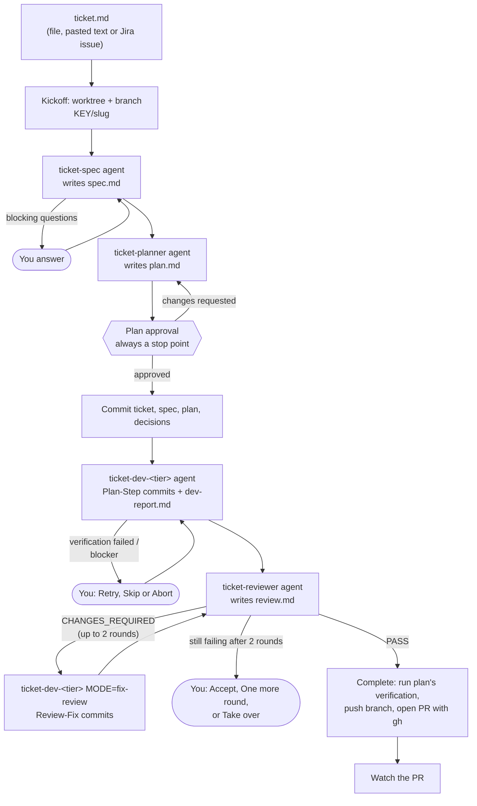
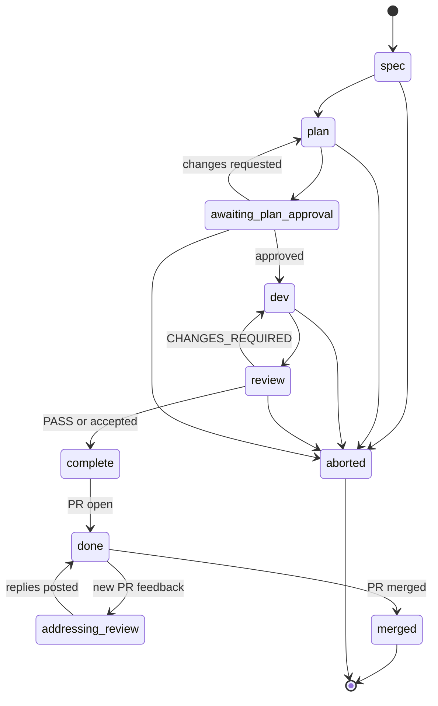
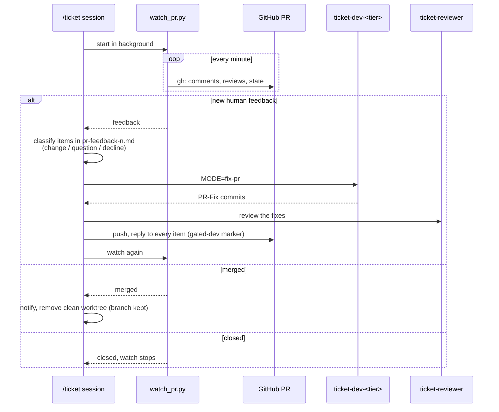
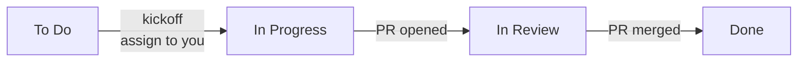
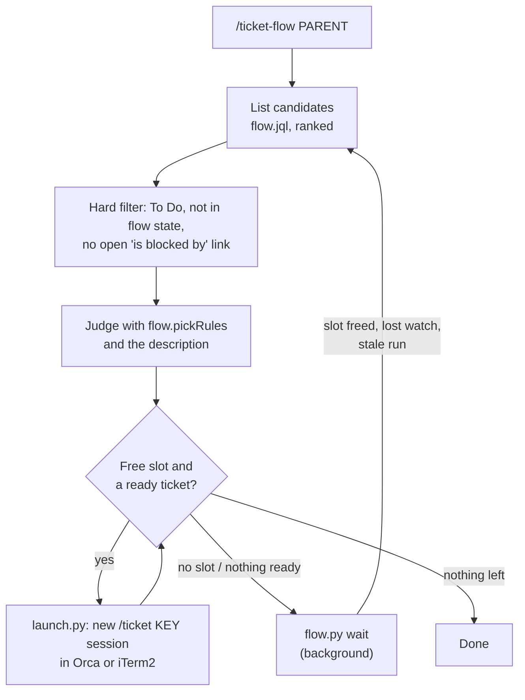

# gated-dev-simple-workflow

`/ticket <KEY>` runs one ticket through **spec → plan → dev → review → PR**,
one subagent per stage, in its own git worktree. The pipeline is file-based:
by default the ticket is a Markdown file (`docs/tickets/<KEY>/ticket.md`), and
every stage reads and writes files next to it. A project can **switch to Jira
issues** instead (see [Jira](#jira)); the stages still work on files.

What ships:

| Part | What it does |
| --- | --- |
| `/ticket` skill | The orchestrator. Runs in your main session, never writes product code, drives the stage agents and talks to you at stop points. |
| Stage agents | `ticket-spec`, `ticket-planner`, three dev tiers (`ticket-dev-godzilla`, `ticket-dev-workhorse`, `ticket-dev-pawn`) and `ticket-reviewer`: one subagent per stage, each writing one file (dev: commits and `dev-report.md`). |
| `/ticket-flow` skill | Works through the subtasks of one Jira parent by launching a `/ticket` session for each. |
| Launcher (`scripts/launch.py`) | Opens one Claude Code session per ticket in a new Orca or iTerm2 tab. |
| PR watcher (`scripts/watch_pr.py`) | Polls the PR in the background and wakes the session on feedback, merge or close. |
| `Notification` hook | Desktop notification when a launched session needs you. |

## How it works

### The pipeline

`/ticket <KEY>` creates (or adopts) a worktree on branch `<KEY>/<slug>`, then
runs one subagent per stage. Each agent reads the files of the stages before
it and ends with `RESULT: OK <file>` or a `NEEDS_DECISION` block; a
`NEEDS_DECISION` stops the run and asks you. The orchestrator records every
answer in `decisions.md` and the stage in `state.json`, so `--resume` can
re-enter any stage.



Stop points (where the run waits for you): blocking spec questions, **plan
approval**, decisions an agent escalates (for example anything in
`riskPaths` or the escalation list), verification failures and other
blockers, the review-loop limit, and agent failures. A prompt or denial from
an approval gate such as `destructive-guard` is treated the same way: as a
checkpoint, never something to work around.

The stages move through these states in `state.json`:



### After the PR opens

The session starts `scripts/watch_pr.py` in the background. It polls the PR
with `gh` once a minute and exits on the first event, which wakes the
session.



### With a Jira tracker

When `tracker` is set in `.claude/gated-dev-simple-workflow/config.json`, the orchestrator (never the
stage agents) uses the session's own Jira tools: it fetches the issue into
`ticket.md` at kickoff and moves it forward at fixed events.



Each stage transition also posts a short `Pipeline:` comment. Statuses only
move forward, and a failed Jira call after kickoff is a warning, not a stop.

### Running a parent: `/ticket-flow`

`/ticket-flow <PARENT>` is a driver session for the subtasks of one Jira
parent. It reads Jira and launches sessions; all Jira writes stay in the
launched `/ticket` sessions.



A run holds a slot from launch until its PR is open (plan approval included);
`flow.max` sets the number of slots. Flow state lives in the git common dir,
so every worktree sees the same picture.

## Usage

```text
/ticket PROJ-1                       # ticket.md must exist, or paste a description:
/ticket add-csv-export Users want to export reports as CSV ...
/ticket PROJ-1 --status
/ticket PROJ-1 --resume
/ticket PROJ-1 --address-review      # address new PR feedback now
/ticket PROJ-1 --mode light          # fix the mode instead of letting the session decide
```

The run stops for you only at fixed points: blocking spec questions,
**plan approval (always)**, important decisions an agent escalates,
verification failures, review-loop limits and agent failures. After the plan
is approved it commits, pushes the ticket branch and opens a PR with `gh`.

### After the PR is open

The session keeps watching the PR (`scripts/watch_pr.py` in the background,
one `gh` poll a minute):

- **New review feedback** from a person (bots and the pipeline's own replies
  are ignored) starts a follow-up round: each item is classified as change,
  question or decline in `pr-feedback-<n>.md` (you confirm every decline and
  decide anything ambiguous or out of scope), the dev agent fixes the changes
  (`PR-Fix: <comment id>` commits), the reviewer checks them, the branch is
  pushed and every item gets a reply marked `<!-- gated-dev -->`. Threads stay
  unresolved and no review is re-requested; that is up to you.
- **Merged**: you get a notification and the worktree is removed when it is
  clean and at the merged commit. The branch is kept.
- **Closed** without a merge: the watch stops; nothing else changes.

Closing the session stops the watch; `/ticket <KEY> --resume` (or the
launcher) restarts it, and catches up on a merge that happened meanwhile.

Worktrees go to `.claude/worktrees/<key>-<slug>` on branch `<KEY>/<slug>`.
In Orca they are created with `orca worktree create`; in iTerm2 and other
terminals with `git worktree add`. A session that already runs in a linked
worktree adopts it.

## Running a whole parent

`/ticket-flow` works through the subtasks of one Jira parent (an epic, or a
story with subtasks) without you choosing each next ticket. It needs a Jira
[tracker](#jira) in `.claude/gated-dev-simple-workflow/config.json` and stops with a message without
one.

```text
/ticket-flow PROJ-100                       # pick, launch, wait, repeat until nothing is left
/ticket-flow PROJ-100 --once                # one pass: fill the free slots, then stop
/ticket-flow PROJ-100 --max 2               # up to two runs at once (overrides flow.max)
/ticket-flow PROJ-100 --dry-run             # show the pick and the launch plan, launch nothing
/ticket-flow PROJ-100 --status              # launched, skipped and merged tickets, free slots
/ticket-flow PROJ-100 --skip PROJ-104 needs a vendor contract
/ticket-flow PROJ-100 --retry PROJ-104      # make a skipped or aborted ticket pickable again
```

- **Pick.** Candidates come from `flow.jql` (default
  `parent = {parent} ORDER BY Rank ASC`, the base priority). A ticket is
  dropped when it is not in a To Do status, is already in the flow state, has
  a run you started by hand (listed, never picked) or has an `is blocked by`
  link to an issue that is not Done. A ticket whose PR the flow saw merged
  counts as Done. Then `flow.pickRules` and the description decide: a ticket
  that needs a person (a meeting, a purchase) or names an unfinished
  dependency is not picked.
- **Launch.** Each pick opens its own `/ticket <KEY>` session through the
  launcher, in the same tabs as [Launching several tickets](#launching-several-tickets).
  The launched session does its own Jira assignment, transitions and comments.
  `/ticket-flow` reads Jira and launches; it never writes to an issue.
- **Slots.** A run holds a slot from its launch until its PR is open or the
  run ends. A run waiting for plan approval holds a slot too. `flow.max`
  (default 1) is the number of slots.
- **Wait.** A background `flow.py wait` wakes the session when a slot frees,
  a PR watch is lost, or a run has been idle for `flow.staleHours`. You get a
  notification for a stale run, a failed launch and a ticket left after its
  relaunch cap.
- **Keep the session open.** Closing the session stops the wait. Running
  `/ticket-flow PROJ-100` again continues from the saved state; it does not
  start over.
- **One driver per parent.** Run one driver session for each parent.
- **Settings.** The `flow` key in `.claude/gated-dev-simple-workflow/config.json` (`max`, `jql`,
  `pickRules`, `pollSeconds`, `staleHours`, `lostWatchMinutes`, `remoteControl`):
  see `skills/ticket/references/config.md`.
- **State.** `$(git rev-parse --git-common-dir)/gated-dev/flow/<PARENT>.json`,
  shared by every worktree and never committed. Each run's own
  `state.json` stays in its worktree; the flow only reads it.

Known limits:

- The lock is held for each state write, not for a whole driver session, so
  it does not stop a second driver for the same parent from picking the same
  ticket.
- A "nothing ready" pick is reported in chat with its reason, but the flow
  state does not record it. Only launch reasons are recorded.
- A lost PR watch (its session was closed while the PR was open) is reopened
  with `launch.py`, which resumes the run and restarts the watch. After 3
  relaunches the ticket is left to you.
- Not decided yet: whether an open PR should hold a slot (today it frees
  one), whether the driver moves the parent issue, and the relaunch cap of 3
  (a constant, not a setting).

## Modes

Not every ticket needs every stage. A run has a **mode**, decided once at
kickoff, that sets which stages run:

| Mode | Stages | Session model (default) | Meant for |
| --- | --- | --- | --- |
| `heavy` | spec → plan → dev → review | `opus` | Unclear or cross-cutting tickets; schema, auth, security, infra, new dependencies |
| `medium` | plan → dev → review | `sonnet` | Clear tickets of normal size |
| `light` | plan → dev | `sonnet` | Small, well-specified changes in one area |

Kickoff and complete (push, PR, PR watch, merge cleanup) run in every mode,
and the **plan approval is a stop in every mode**, light included.

- **Choosing.** `--mode heavy|medium|light` wins; then the config key `mode`
  (anything but `auto`); otherwise the `/ticket` session decides from the
  ticket (escalation list, `riskPaths`, open questions, number of areas,
  size) and takes the heavier mode when unsure. `modeRules` adds your own
  plain-language rules. The session never asks you which mode; you can
  redirect it at plan approval.
- **Raising.** A mode is only ever raised, never lowered: the planner can ask
  for a heavier one, you can ask at plan approval ("use heavy"), and a light
  run whose diff touches `riskPaths` gets a review. Gated operations in the
  plan alone do not raise a light run.
- **`--mode`** works on `/ticket`, on the launcher (`launch.py --mode light
  PROJ-1`, which also starts the session on that mode's model) and on
  `flow.py launch`. `/ticket-flow` decides each subtask's mode itself and
  always launches with `--mode`.
- **Session model.** `modes.<mode>.session` is the model the launcher starts
  the session on. `haiku` is not allowed: the session is the orchestrator and
  needs sonnet or opus. A session you started by hand on a weaker model than
  the mode wants asks you to restart or continue.

Config keys `mode`, `modes` and `modeRules` are in
[Configuration](#configuration). The rules in full, the records in
`state.json` and the session-model question:
[`skills/ticket/references/modes.md`](skills/ticket/references/modes.md).

## Ticket files and run state

Write `docs/tickets/<KEY>/ticket.md` (the first `# ` heading is the title; it
names the branch and the PR; optional front matter `base:` picks the base
branch), or paste a description after the key and `/ticket` writes the file.
Commit it on the base branch or leave it untracked: kickoff copies it into the
ticket worktree. Every stage works on files next to it:

| File | Written by | Committed |
| --- | --- | --- |
| `ticket.md` | you / kickoff | at plan approval |
| `spec.md` | spec agent | at plan approval |
| `plan.md` | planner | at plan approval |
| `decisions.md` | orchestrator (your answers at stop points) | at plan approval, then on every append |
| `dev-report.md` | dev agent | by the dev agent |
| `review.md` | reviewer | after each review round |
| `pr-feedback-<n>.md` | orchestrator (PR follow-up round `n`) | at the start of the round |
| `state.json` | orchestrator | never (ignored through `.git/info/exclude`) |

`state.json` records the stage, which `--status` prints and `--resume`
re-enters from its start: `spec` → `plan` → `awaiting_plan_approval` → `dev`
→ `review` → `complete` → `done` ⇄ `addressing_review` → `merged` (or
`aborted`). It also holds the branch, worktree, base, review round,
decisions, warnings, the PR URL, the time of the last PR feedback handled
(`lastAddressedCommentAt`) and the watcher's heartbeat (`watch`).

## Configuration

Optional, per clone, in `.claude/gated-dev-simple-workflow/config.json` of the
main checkout. The file is local and git-ignored: the first run of
`/ticket`, the launcher or `/ticket-flow` adds
`/.claude/gated-dev-simple-workflow/` to `.git/info/exclude` and creates the
file, moving an old `.claude/gated-dev.json` there or copying the template
[`templates/config.json`](templates/config.json), which lists every key with
its default (commit the deletion of the old file afterwards). A key set to
`null` means the default. Sessions in worktrees, the launcher and
`/ticket-flow` all read the main checkout's copy. Every key is optional; an
invalid file or an unknown key stops the run with a message. Example:

```json
{
  "ticketsDir": "docs/tickets",
  "keyPattern": "^[A-Z]+-\\d+$",
  "baseBranch": "develop",
  "setupCommand": "npm ci",
  "formatCommand": "prettier --write",
  "riskPaths": ["**/migrations/**", "src/auth/**"],
  "escalationExtra": ["any change to the public API of packages/sdk"],
  "devTier": "auto",
  "models": { "plan": "opus", "reviewRisk": "opus", "devWorkhorse": "sonnet" }
}
```

Modes (see [Modes](#modes)) use three more keys: `mode` (`auto` by default, or
a fixed mode), `modes` (`{"light": {"session": "sonnet"}}`, session model per
mode; `opus`, `sonnet` or a `claude-...` id, never `haiku`) and `modeRules`
(a list of extra rules for the mode decision).

Regex backslashes are doubled in JSON (`\\d`, not `\d`). Every key, its
default and the ticket file format: `skills/ticket/references/config.md`.

`devTier` picks the developer tier: `auto` (default; the planner advises, the
orchestrator decides at plan approval) or a fixed `godzilla`, `workhorse` or
`pawn`. The dev model per tier is `models.devGodzilla` (default `opus`),
`models.devWorkhorse` (`sonnet`) and `models.devPawn` (`haiku`). `models.dev`
is gone: it stops the run with "`models.dev` was replaced by
`models.devWorkhorse` (and `devGodzilla`, `devPawn`)".

### Project rules

`"orchestratorRules": ".claude/gated-dev-rules.md"` points to a Markdown file
with extra steps the orchestrator runs at fixed events: `intake` (no
`ticket.md` yet: the rules may write it), `started`, `resumed`, `spec-done`,
`plan-approved`, `dev-done`, `review-done`, `pr-body`, `pr-opened`,
`pr-feedback-addressed`, `merged`, `aborted`. One `## <event>` section per
event:

```markdown
Team notifications go through the chat tool; use its MCP tools.

## plan-approved
Add a line for this ticket to CHANGELOG.md under "Unreleased".

## pr-opened
Post the PR link to the team channel with `mcp__chat__send_message`.

## merged
Post "<KEY> merged" to the team channel with `mcp__chat__send_message`.
```

Steps only add to the pipeline: they cannot skip a stop point, change what
the stage agents get, or widen what the approved plan allows. A failing step
is recorded as a warning and the run goes on (except at `intake`). With a
[tracker](#jira), the rules run after the tracker step at each event and may
not define `intake`. Details: `skills/ticket/SKILL.md` section 0a.

## Jira

Off by default. Without `tracker` nothing in this section applies: `ticket.md`
is the ticket and no Jira call is ever made.

**Requirement:** a Jira MCP server or connector in the Claude Code session,
with rights to read issues, list and apply transitions, comment and assign
(and to read the current user). No API tokens and no client of its own.
Without these tools, kickoff stops before creating anything.

Minimal config in `.claude/gated-dev-simple-workflow/config.json`:

```json
{ "tracker": { "type": "jira", "site": "acme.example.net" } }
```

`/ticket PROJ-1` then fetches the issue (summary, description, type, status,
parent, links, the last human comments) and writes it to `ticket.md`. The key
pattern defaults to `^[A-Z][A-Z0-9]*-\d+$`.

| When | Status moves | Only if the status is |
| --- | --- | --- |
| Kickoff | To Do to In Progress | in `startFrom` (default: any To Do category status) |
| PR opened or reused | In Progress to In Review | In Progress (or a `startFrom` status) |
| PR merged | to Done | not already Done |

The pipeline never moves an issue backwards and makes no other status change
(no change on abort, restart, PR feedback rounds or resume).

What lands in Jira: the issue is assigned to you at kickoff (`"assign": false`
turns that off), and a short `Pipeline:` comment (Done / Next / Blockers) is
posted at each stage transition, with the PR link when it opens. Set
`"comments": false` to post none; status changes happen either way.

Customise in the `tracker` object:

- `statuses`: target names, `{"inProgress": "In Progress", "inReview": "In
  Review", "done": "Done"}` by default. `"inReview": null` skips that step for
  workflows without In Review.
- `startFrom`: statuses kickoff may move to In Progress.
- `site`: needed only when the tools reach several Jira sites.
- `baseFromParent`: a branch glob such as `feature/{parent}/*`. If the issue
  has a parent and exactly one matching branch exists on `origin`, it becomes
  the base; none means the normal base rules; several ask you.

A failed Jira call after kickoff is a warning, not a stop: `/ticket KEY
--status` lists it and the run goes on. Kickoff stops only when the issue
cannot be read or the session has no Jira tools.

The stage agents never touch Jira and read only `ticket.md`, which is
generated from the issue and committed with the spec and plan. Every key and
the file format: `skills/ticket/references/config.md`; behaviour:
`skills/ticket/references/jira.md`.

## Launching several tickets

`/gated-dev-simple-workflow:launch` (or the script directly) opens one new
Claude Code session per ticket, each running `/ticket <KEY>`, in a new Orca
or iTerm2 tab:

```bash
python3 -I <plugin>/scripts/launch.py --dry-run PROJ-1 PROJ-2   # show what would open
python3 -I <plugin>/scripts/launch.py PROJ-1 PROJ-2
python3 -I <plugin>/scripts/launch.py --all                     # every ticket.md without a run
```

| Case | Where the session starts |
| --- | --- |
| New ticket, Orca, repo registered in Orca | A new Orca worktree on `<KEY>/<slug>` (base: front matter `base:`, `baseBranch`, `origin/HEAD`, `main`), with `ticket.md` and `.claude/settings.local.json` copied in; the session adopts it |
| New ticket, iTerm2 (or a repo Orca does not know) | The main checkout; the session creates its worktree |
| New ticket without `ticket.md`, `orchestratorRules` set | The main checkout; the session's `intake` rules write the ticket, then it creates its worktree |
| New Jira key without `ticket.md` (`tracker` set) | The main checkout, titled with the plain key; the session fetches the issue and writes `ticket.md`, then creates its worktree |
| Ticket with a run | Its worktree, with `/ticket <KEY> --resume` (for a finished run, `stage: done`, that restarts the PR watch) |

Sessions are named `<KEY> · <title>` (`<KEY> resume · <title>`) and get
`TICKET_FLOW_KEY`; `--remote-control` also starts them with Remote Control.
Outside Orca and iTerm2 only `--dry-run` works.

### Notifications

Launched sessions (those with `TICKET_FLOW_KEY`) show a desktop notification
titled `<KEY> needs you` whenever Claude Code raises a `Notification` event:
a permission or gate prompt, a stop point such as plan approval, or an idle
wait for input. macOS uses `osascript` (with a sound), Linux uses
`notify-send` when it is installed; other systems stay silent. The message
comes from the event (a generic text when it has none). Sessions started
by hand are never notified by the hook. While a session only watches its PR,
Claude Code's idle notice fires once too. A merge sends `<KEY> merged` from
any session. Set `GATED_DEV_NOTIFY=0` to turn all of it off. The hook needs Python >= 3.14
(`GATE_INFRA_PYTHON`, else `python3.14`, else `python3`); without it the hook
stays silent.

## Agents

| Agent | Stage | Writes |
| --- | --- | --- |
| `gated-dev-simple-workflow:ticket-spec` | 1. spec | `spec.md` |
| `gated-dev-simple-workflow:ticket-planner` | 2. plan | `plan.md` |
| `gated-dev-simple-workflow:ticket-dev-godzilla` | 3. implement / fix, heavy work | commits + `dev-report.md` |
| `gated-dev-simple-workflow:ticket-dev-workhorse` | 3. implement / fix, the normal case | commits + `dev-report.md` |
| `gated-dev-simple-workflow:ticket-dev-pawn` | 3. implement / fix, mechanical steps only | commits + `dev-report.md` |
| `gated-dev-simple-workflow:ticket-reviewer` | 4. review | `review.md` |

The three dev agents share one contract and differ in model, effort and
latitude:

| Tier | Model (default) | Effort | For |
| --- | --- | --- | --- |
| `godzilla` | `opus` | high | Heavy work: restructuring within the planned files, steps that leave the approach open. |
| `workhorse` | `sonnet` | high | The normal case: the plan as written, small local choices. |
| `pawn` | `haiku` | medium | Mechanical steps the plan spells out (copy, config, docs, renames, a test for a known case). |

Each ends with `RESULT: OK <file>` or a `NEEDS_DECISION` block. A prompt or
denial from an approval gate (for example the `destructive-guard` plugin) is
treated as a checkpoint, never worked around.

The planner lists the calls its steps need that it judges likely to need
approval in the plan's `## Gated operations` table (columns `Command`, `Gate`,
`Reason`); you see that table at plan approval. `Gate` is `unknown` by
default. With `"dryRunGate": true` in `.claude/gated-dev-simple-workflow/config.json` and
`destructive-guard` installed and enabled, the planner dry-runs each listed
call through `destructive-guard:check` and writes the answer, for example
`ask (risk 0.86)`. Each check is one request to the gate's risk classifier
and sends the redacted command, which is why it is opt-in.

## Design decisions and history

This section replaces the finished plan files that used to sit in
`docs/plans/`. Git history keeps the full text.

### Origin and binding decisions

The `/ticket` pipeline (skill, four stage agents, launcher, PR watcher)
started inside a private project and was generalised into this plugin.
Decisions made with the user while porting it:

- **Workflow and gates are separate.** The pipeline knows nothing about gate
  internals. It runs the same with or without `destructive-guard` and treats
  any gate prompt or denial as a checkpoint (`NEEDS_DECISION`), never as
  something to work around. Its only coupling is a contract: when the gate's
  `check` skill is installed, the planner dry-runs its calls through it.
  Otherwise (or without `dryRunGate`) it writes `Gate: unknown`. No path into
  the other plugin is hard-coded.
- **Files by default, Jira optional.** The ticket is
  `<ticketsDir>/<KEY>/ticket.md`, and the key is free-form. The first port
  ruled out any tracker (2026-11-19). That was reversed on 2026-11-21: with
  `tracker` in `.claude/gated-dev-simple-workflow/config.json`, the orchestrator fetches the issue
  into `ticket.md` and moves it through its statuses using the session's own
  Jira tools. The stage agents stay tracker-free either way. Other tracker
  steps go into `orchestratorRules` (one section per pipeline event).
- **Orca and iTerm2 are supported**, as well as plain `git worktree`. The
  skill detects the host and adopts a linked worktree it was opened in. The
  launcher opens one session per ticket.
- **Plan approval is always a stop point.** After it, the run commits,
  pushes, opens a PR with `gh` and watches it. New feedback starts a
  follow-up round; a merge sends a notification and removes the worktree
  (the branch is kept).
- **Public repo hygiene:** no source-project names, ticket keys or branch
  names, and neutral placeholders (`PROJ-1`, `apps/web`).

### What was checked end to end

The pipeline was run in a private demo repo: by hand, through the launcher
in Orca and in iTerm2, headless (`claude -p '/gated-dev-simple-workflow:ticket <KEY>'`,
`--continue` to answer a stop point), `--status`, interrupt plus `--resume`,
gated rows with real rule IDs, the `unknown` path without the gate, spec
questions, a denial treated as a checkpoint, and a full PR feedback round
through to merge and cleanup. Findings worth knowing:

- The plugin cache is a copy. After changing the plugin, run
  `claude plugin update gated-dev-simple-workflow@gep-claude-marketplace` in
  the project before the next run.
- The launcher read `.claude/gated-dev.json` from the main checkout, while
  a session in a worktree read the base branch's copy, so they could differ.
  Since 0.16 the config is a local file that everything reads from the main
  checkout.
- A `Bash(git push:*)` deny in Claude Code settings doesn't match
  `git -C <worktree> push`.
- The watcher exits `0` for feedback, merged or closed, `1` on error and
  `2` on usage errors. Distinct non-zero codes per outcome made Claude Code
  report a merge as a failure.

### Python port (0.9, November 2026)

The launcher, the PR watcher and the notification hook were rewritten in
Python (>= 3.14, standard library only), and the repo contains no
JavaScript. `hooks/notify.py` starts through `hooks/run-python.sh`, which
uses the same interpreter lookup as the gate (`GATE_INFRA_PYTHON`, then
`python3.14`, then `python3`, always with `-I`). Unlike the gate,
notifications are best-effort: with no suitable Python the hook stays
silent. `jq` is no longer needed. An installed `destructive-guard` older than its
Python version has no `lib/check.py`, so the planner writes `unknown` in
the `Gate` column.

### Class refactor (November 2026)

One class per file, with no change in behaviour:
- `gated_dev/launch/`: naming, terminal commands, ticket project, Orca
  worktrees, launcher, CLI;
- `gated_dev/watch/`: PR client, feedback detector, watcher, CLI;
- `notify.py`, `process.py` and `errors.py`.

### Jira tracker (0.10, November 2026)

Opt-in Jira support, built in three work packages (J1 skill contract, J2
launcher, J3 docs and release). Binding decisions:

- **Off unless `tracker` is set.** Without it the pipeline behaves as before
  and makes no Jira call. Every Jira step in the skill is guarded by "when
  `tracker` is configured", and tests pin both modes.
- **The session's own Jira tools,** described by capability (read an issue,
  list and apply transitions, comment, assign, current user). No Python Jira
  client, no API tokens, and shipped files never name an MCP server or its
  tools (`tests/test_no_named_mcp.py` guards this).
- **One reference, `skills/ticket/references/jira.md`,** holds the behaviour;
  `SKILL.md` calls it at fixed events (`started`, `resumed`, `spec-done`,
  `plan-approved`, `dev-done`, `review-done`, `pr-body`, `pr-opened`,
  `pr-feedback-addressed`, `merged`, `aborted`), tracker step first, then the
  project's rules. With a tracker the rules may not define `intake`.
- **Stage agents stay tracker-free.** They get one generic rule: never change
  anything outside the worktree through any tool, because they inherit the
  session's Jira tools.
- **Forward-only statuses:** kickoff → In Progress, PR opened or reused → In
  Review (new; the source never had it), merge → Done. Abort, restarts and PR
  feedback rounds change nothing. A transition is found by target status
  name, then by transition name.
- **Failures are warnings** in `state.warnings` (stage `tracker`) and never
  stop the run, except an unreadable issue or missing Jira tools at kickoff,
  which stop before anything is created. Failed comments queue in
  `state.tracker.pending`. A merged PR removes its worktree even when Jira
  lags.
- **Launcher:** `TicketProject.read_config` validates `tracker`, and a Jira
  key with no `ticket.md` opens in the main checkout titled with the plain
  key. `--all` never queries Jira.
- **Not built:** other trackers (`tracker.type` leaves room), and moving the
  issue back during PR feedback rounds. The parent-based picker came in 0.11
  (see [Ticket flow](#ticket-flow-011-november-2026)).

Still to do: a manual acceptance run in a demo repo with a sandbox Jira
project (never a real team project). It covers the kickoff, the move to In
Review at PR open, a PR feedback round, merge and `--resume` (no second
merged comment), a missing target status (warning only) and a session
without Jira tools (kickoff stops). The step-by-step plan, with the full
acceptance list, is in git history (`docs/plans/jira-tracker/`).

### Ticket flow (0.11, November 2026)

`/ticket-flow <PARENT>` picks the subtasks of one Jira parent and launches
each as a `/ticket` session. Built in five work packages (F1 flow state, F2
wait and CLI, F3 launcher summary and config, F4 skill and references, F5 docs
and release). Binding decisions:

- **D1. A skill with a Python helper.** The skill does the Jira reads and the
  judgement; `scripts/flow.py` does everything deterministic (state, git,
  `gh`, launching, waiting) and has tests. Same split as `/ticket` and
  `watch_pr.py`. The skill uses the session's Jira tools, not a Jira client.
- **D2. Waiting is a background process that exits on an event.** `flow.py
  wait` polls and prints one JSON line; the session wakes, acts and waits
  again. Closing the session stops it; `/ticket-flow` continues from the
  saved state.
- **D3. Flow state in the git common dir**
  (`$(git rev-parse --git-common-dir)/gated-dev/flow/<PARENT>.json`): shared
  by every worktree, never committed. Runs keep their own `state.json`, which
  the flow only reads.
- **D4. Two-step pick.** A hard filter on the Jira data (status, exclusions,
  `is blocked by` links), then judgement with `flow.pickRules`. Launch
  reasons are recorded in the state; a "nothing ready" reason is only shown
  in chat (a known limit).
- **D5. Merged means Done for the pick,** even when Jira has not caught up.
- **D6. A slot is a run that needs the pipeline.** `awaiting_plan_approval`
  holds a slot; `done` (PR open) and the ends (`merged`, `aborted`) free it.
  `flow.max` defaults to 1.
- **D7. Jira writes stay in `/ticket`.** `/ticket-flow` reads Jira and
  launches sessions, nothing else.
- **D8. Requires `tracker`.** A file-based flow is not part of it.

Known limits and open questions are in [Running a whole parent](#running-a-whole-parent).
The manual acceptance run (a demo repo and a sandbox Jira project, never a
real team project) is still to do. The plan is in git history
(`docs/plans/ticket-flow.md`).

### Ticket modes (0.13, November 2026)

`heavy`, `medium` and `light` modes cut the pipeline for tickets that do not
need all of it (details: [modes.md](skills/ticket/references/modes.md)). Built
in eight work packages: config keys, launcher (`--model`, `--mode`), flow CLI,
the `modes.md` and pipeline-spec references, stage agents, the `/ticket`
orchestrator, `/ticket-flow`, then docs and release. Binding decisions:

- **D1. Decided once, at kickoff, without asking.** Medium and light skip the
  spec stage, so the decision cannot come later. The developer redirects at
  plan approval, which stays a stop in every mode.
- **D2. Rules in a fixed order.** `--mode`, config `mode`, then the ticket
  against the escalation list, `riskPaths`, open questions and size; the
  heavier mode when unsure.
- **D3. Raise only.** The planner, the developer at plan approval and a
  `riskPaths` hit after dev in light mode can raise; nothing lowers.
- **D4. The session model follows the mode.** A running session cannot change
  its model, so the launcher starts it on `modes.<mode>.session`.
- **D5. The stage set is not configurable.** A configurable list would make
  the approval points and the state machine depend on the project.
- **D6. Without a spec, the plan carries the acceptance criteria.** The
  planner writes `## Acceptance criteria` from `ticket.md`; dev and reviewer
  read them from `spec.md` when it exists, else from `plan.md`. A missing or
  unclear criterion is a planner `NEEDS_DECISION`, which takes over the
  role of the post-spec stop.
- **Settled while building.** The session-model question comes after kickoff
  setup, so a restart loses nothing; the restart command starts with
  `cd '<worktree>'`. A run without a recorded mode counts as heavy. Raising to
  heavy is only possible before plan approval. A light PR feedback round
  re-checks `riskPaths` before skipping the reviewer. The launcher refuses
  `--mode` for a key that already has a run (the recorded mode wins).
- **Decided 2026-11-22.** A hand-started session on a weaker model than the
  mode wants asks restart or continue (a weaker mode in a stronger session is
  never asked). Light mode gets no review just because the plan lists gated
  operations: only `riskPaths` or an explicit raise add it. `haiku` is
  forbidden as a session model: the session is the orchestrator, and the
  config check rejects `haiku` and any `claude-...haiku...` id.
- **Left for later.** With dev tiers (a separate plan), the mode would bound
  the tier: heavy at least `workhorse`, light at most `workhorse`.

The manual acceptance run (a private demo repo) is still to do: one ticket
per mode, a `/ticket-flow` parent with small and large subtasks, a light
ticket touching `riskPaths`, a planner raise to heavy, a hand-started Sonnet
session that decides heavy, and `--resume` of a light run. The plan and its
task files are in git history (`docs/plans/ticket-modes*`).

### Dev tiers (0.14, November 2026)

The single dev agent became three tiers, so cheap work does not run
on the strongest model and hard work does not run on the weakest. Built in
six work packages (config, three agents, planner advice, pipeline spec,
orchestrator, docs and release). Binding decisions:

- **Three agents, one contract.** `ticket-dev-godzilla` (opus, high),
  `ticket-dev-workhorse` (sonnet, high) and `ticket-dev-pawn` (haiku, medium)
  share trailers, report and escalation list; only "Your level" differs.
  The old single agent is gone. `models.dev` is replaced by `models.devGodzilla`,
  `devWorkhorse` and `devPawn` and is a config error.
- **Choice.** The planner advises a tier in `plan.md` (`## Dev tier`); the
  orchestrator decides at H2 by the first rule that applies: config
  `devTier`, a tier the developer named, `workhorse` instead of `pawn` when
  gated operations, `riskPaths` files or a marked risk are involved, the
  planner's tier, `workhorse`. It is stored in `state.devTier`.
- **Pawn runs on haiku (2026-11-22).** Pawn stops with `tier too low` when a
  step needs a choice the plan does not make.
- **Promotion (2026-11-22).** Automatic, all the way up, in every dev mode
  (`implement`, `fix-review`, `fix-pr`), for `tier too low` and
  `verification failed`; each tier is left at most once per run. From
  `godzilla`, `verification failed` is H6 and `tier too low` is H3.
- **Implementation choices.** A promotion applies to the current dev run only:
  `devTier` stays as decided at H2, and every promotion is recorded in
  `devTierHistory` and `warnings`. `--resume` in stage `dev` uses the highest
  tier already reached. Fix-review round 2 and later run one tier up; a fix-pr
  round uses `pawn` for purely mechanical feedback.
- **With modes.** The mode bounds the tier of every dev run: heavy at least
  `workhorse`, light at most `workhorse` (a light plan that needs `godzilla`
  raises the mode instead). Promotion is not bounded by the mode.
- **Left out: O1.** A tier per plan step is an open question and not part of
  this version.

The manual check (a docs ticket → `pawn`, a normal feature → `workhorse`, a
decided schema change → `godzilla`, forced promotions, wording-only PR
feedback → `pawn`, and pawn on haiku keeping the dev contract) is still to
do in the demo repo. If pawn breaks the contract, the first fix is a tighter
"Your level" section, not a different model.

### Dev tasks (0.15, November 2026)

One dev agent built the whole plan, and on big tickets its context window
ran out. The planner now groups the steps into tasks (`## Tasks` in
`plan.md`: `Steps`, `Read first`, `Provides`, `Tier`), and the `/ticket`
skill spawns one dev agent per task with `TASK=T<n>`, one after the other in
the same worktree. Binding decisions:

- **Sequential only.** Tasks run in order, never in parallel: parallel agents
  in one worktree would see each other's half-done changes and race on git,
  and separate worktrees per task cost more than they save.
- **Small contexts.** A task agent reads its own steps, its `Read first`
  files and the `Provides` contracts of earlier tasks, not the whole plan.
- **Tier per task.** The H2 tier rules run per task (`state.taskTiers`);
  `devTier` is the plan's tier, at least the highest task tier, and runs the
  fix rounds. Promotion is per task (`devTierHistory` entries get `task`).
  This answers O1 of the dev tiers at task level.
- **Verification.** Every task runs its steps' checks; only the last task
  runs the plan's `## Verification` and completes `dev-report.md` (one
  `## Task T<n>` section per earlier task). Resume continues with the first
  task that has a step without a `Plan-Step` commit. A plan without
  `## Tasks` runs one agent as before.

### Local config (0.16, November 2026)

The config was `.claude/gated-dev.json`, committed with the project, and
each checkout read its own copy: a worktree session saw the base branch's
version, the launcher the main checkout's. It now lives in
`.claude/gated-dev-simple-workflow/config.json` of the main checkout and is
local. Binding decisions:

- **Created on first use, not on install or update.** Claude Code plugins
  have no install or update hook, and a `SessionStart` hook would add the
  folder to every repo opened. The first `/ticket` session, launcher or
  `/ticket-flow` command in a clone creates the file.
- **Ignored through `.git/info/exclude`.** The same step appends
  `/.claude/gated-dev-simple-workflow/` next to the existing pipeline
  entries, so the project's `.gitignore` is never changed.
- **One copy per clone.** The skill, the launcher and the flow CLI all read
  the main checkout's file (first entry of `git worktree list`), never a
  worktree's.
- **Migration by moving.** When the new file is missing and the old
  `.claude/gated-dev.json` exists, it is moved (not copied), so the settings
  carry over and only one file is left; the developer commits the deletion.
  Without either file, the template `templates/config.json` is copied: every
  key with its default, `null` where the default is "not set". A test keeps
  it equal to the defaults in code and in SKILL.md section 8 (`riskPaths`). Dry runs and `--status` move nothing
  and read the old file.

### Lean gate follow-up

`destructive-guard` 1.0 decides with the Jev classifier only and has no rule
ids. The `## Gated operations` table therefore has a `Gate` column instead of
`Rule ID`, filled from `check` only when `dryRunGate` is true (decision D6 of
the `destructive-guard` README, option b: a check costs a Jev request and sends the
command).

## Requirements

`git`, and `gh` (authenticated) for the PR; `orca` when running in Orca; **Python >= 3.14** (standard library only) for the launcher, the PR watcher and the notification hook (`python3`, or `GATE_INFRA_PYTHON` when `python3` is older; install with `brew install python@3.14`, `uv python install 3.14` or from python.org); optional `notify-send` (Linux) for notifications (silent without Python).

## Install

```text
/plugin marketplace add gep/gep-claude-marketplace
/plugin install gated-dev-simple-workflow@gep-claude-marketplace
```
